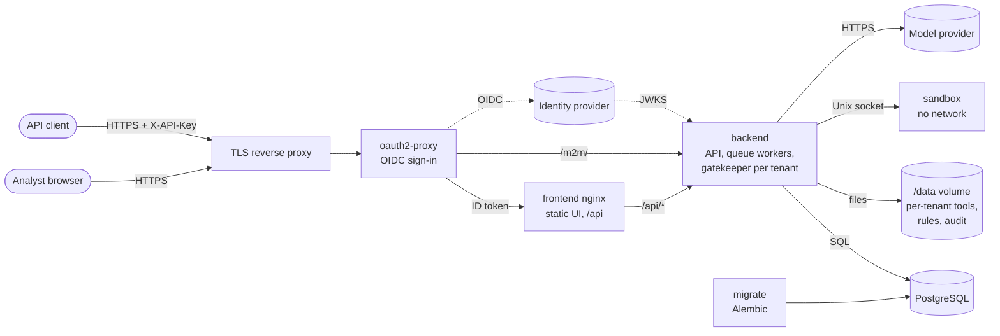
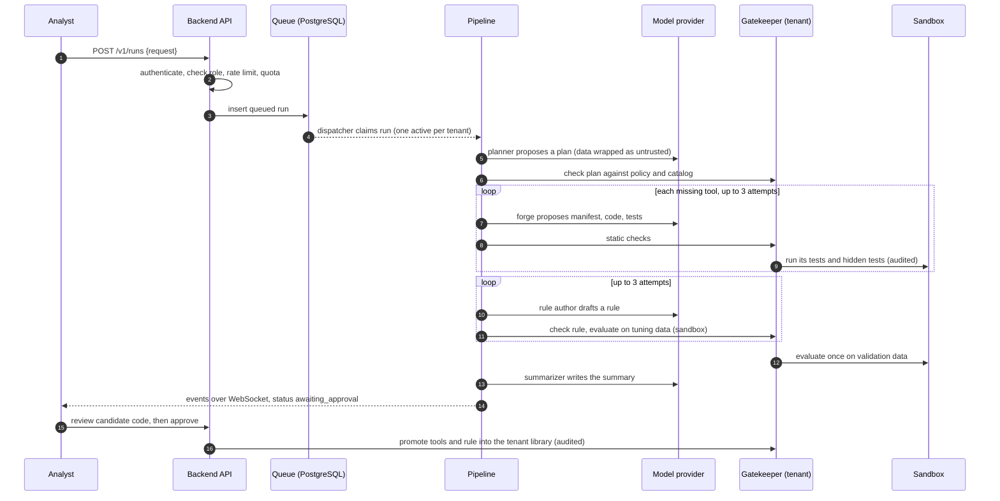

<!-- Copyright (c) 2026 Adam Krúpa and Ondra Csajka. MIT License. -->
# Architecture

Toolsmith is an agent for security analysts. An analyst describes an attack; the agent plans the work, builds the tools it is missing (log parsers, aggregations, enrichments), tests them in an isolated sandbox, drafts a detection rule, validates it on independent data and asks a human to approve. Approved tools join the tenant's library and are reused by later runs.

The design rule: **language models only propose; a deterministic gatekeeper decides; a human approves.**

## Deployment

| Component | Code | Responsibility |
|---|---|---|
| oauth2-proxy | `docker-compose.yml` | Signs users in; forwards the provider's ID token; the only published service. |
| Backend API | `backend/orchestrator/main.py`, `auth.py`, `admin_api.py`, `privacy_api.py` | Versioned REST API (`/v1`), WebSocket events, authentication, roles, tenant administration, privacy. |
| Queue | `backend/orchestrator/dispatcher.py`, `backend/storage/runs.py` | Durable run queue in PostgreSQL, one active run per tenant, retries, cancellation. |
| Pipeline and roles | `backend/orchestrator/pipeline.py`, `planner.py`, `forge.py`, `rule_author.py`, `summarizer.py`, `llm.py` | Calls the model for proposals; shape checks; usage and cost accounting; prompt versions. |
| Gatekeeper | `backend/gatekeeper/` | Policy, static analysis, plan and rule validation, hidden tests, evaluation, tool registry, hash-chained audit. One instance per tenant. |
| Examiner (optional) | `backend/examiner/` | Generates independent test data for attack types without a dataset. |
| Sandbox | `sandbox/` | Runs generated code: fresh process per job, private UID, no network, strict limits. |
| Identity | `backend/identity/` | OIDC token verification, users, tenants, memberships, invitations, API keys, rate limits. |
| Storage | `backend/storage/` | SQLAlchemy models, Alembic migrations, repositories. |

## One run, end to end

Every step emits an event that is stored in PostgreSQL before it is sent over the WebSocket, so the browser can replay a run after a reconnect or a restart.

## Data

- **PostgreSQL:** tenants, users, memberships, invitations, API keys, runs, run events, model usage (`backend/storage/models.py`, migrations in `backend/storage/migrations`).
- **`/data/tenants/<tenant id>/`:** the tool registry (code, tests, manifests with SHA-256 digests), candidates of runs awaiting approval, approved rules, lessons from rejected or failed runs, per-run usage files, and the tenant's hash-chained `audit.jsonl`.
- **Read-only inputs in the image:** `backend/policy/policy.yaml`, `backend/datasets` (tuning and validation data with labels), `backend/seed_skills`.

## Trust boundaries

- The orchestrator imports only the gatekeeper's public API and shared types. It never reads datasets, labels or the registry and never runs skills; architecture tests enforce this (`backend/tests/architecture/test_boundaries.py`).
- The gatekeeper has no language model dependency. It loads verified datasets (SHA-256 manifest), runs AST and schema checks, evaluates the recipe and computes incidents, TP/FP/FN and the pass thresholds. It reaches the sandbox over a Unix socket.
- A candidate tool must pass its own tests and independent hidden tests. Code, manifest and tests are fingerprinted, and promotion checks that the code that passed validation is the code being installed.
- The sandbox has no network, secrets, datasets, registry or Docker socket. It is read-only with tmpfs, runs jobs as private unprivileged UIDs with limited capabilities, memory, CPU and processes, and its runner guards imports and file access.
- The optional examiner (`EXAMINER_ENABLED`) only receives a description of the attack and log format. The gatekeeper statically checks its generator, runs it in the sandbox with private seeds, checks the labels and parser, and adds fixed normal traffic. The data belongs to that run and never reaches the planner or the rule author.
- Approved tools, rules and lessons live in the tenant's `/data` directory and survive restarts. After the password-spraying scenario, `distinct_count_window` is reused for distributed brute force and no tool needs to be built. Changed artifacts are quarantined.
- The datasets are synthetic: they make the demo reproducible but say nothing about accuracy on real traffic. The Python sandbox is defence in depth; the container and process limits are the load-bearing part and must not be disabled.

## Security model in one paragraph

Model output is untrusted. External data reaches the model only inside escaped `untrusted_data` blocks. Tools are checked statically, run in a sandbox without network as a private UID with no capabilities, are tested against hidden tests, and rules are measured on two datasets. A human reviews the code and approves. Users are authenticated by the identity provider, tenants are isolated in every query, file path and event stream, and every decision and sandbox execution lands in a per-tenant hash chain. See `SECURITY.md` and `Docs/THREAT_MODEL.md`.

## Decisions

The reasons behind each part are recorded in `Docs/DECISIONS.md` (D-001 to D-020).
